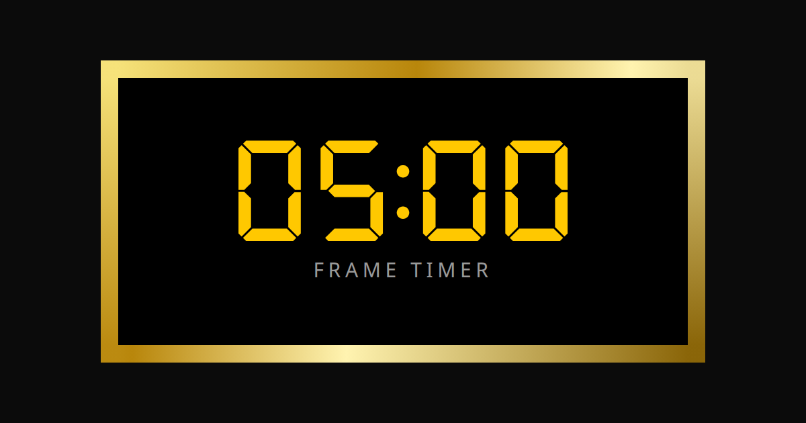

# Timer in Frame

A full-screen countdown timer that sits **behind a picture frame**, for showing time
on an LED TV during a presentation or a prize delivery. Drag the timer and the frame
anywhere, resize both, pick your own frame image.



## Features

- Countdown in `mm:ss` or `hh:mm:ss`; keeps counting in red once it passes zero
- 7-segment LED font (DSEG7), plus sans / mono / serif, in three weights
- Timer renders **behind** the frame image, so the frame overlaps the digits
- Drag to move, corner grip to resize — for the timer and the frame separately
- Any frame image (PNG with a transparent centre works best), or no frame at all
- Text and background colour pickers
- Fullscreen, hideable toolbar
- No build step, no dependencies, works offline

## Usage

Open `index.html` through a web server (some browsers block local font and script
loads over `file://`):

```bash
python3 -m http.server 8000
```

Then visit `http://localhost:8000`.

### Controls

| Control | What it does |
|---|---|
| Duration box | Start time, `mm:ss` or `hh:mm:ss` |
| Start / Reset | Reset re-reads the duration box |
| Move | Which box you drag — Timer or Frame; the other is click-through |
| Frame | Uncheck to hide the frame entirely |
| Image | Load your own frame image |
| Font / Weight / Text / BG | Appearance of the digits and background |
| Fullscreen | Or press `F` |

Keys: `Space` start/pause · `H` hide the toolbar · `F` fullscreen.

While the timer runs, the dashed outline and the resize grip disappear, so the
display is clean for the audience.

## Project layout

```
index.html   markup
style.css    styles
app.js       timer, drag and resize logic
frame.svg    the default gold frame (transparent centre)
fonts/       DSEG7 Classic, self-hosted so it works offline
```

## Contributing

Issues and pull requests are welcome. Keep it dependency-free and keep the
three source files small.

## License

[MIT](LICENSE) © Sidheeq Pallam.

The DSEG7 font by [keshikan](http://www.keshikan.net) is bundled under the SIL Open
Font License — see [fonts/DSEG-LICENSE.txt](fonts/DSEG-LICENSE.txt).
